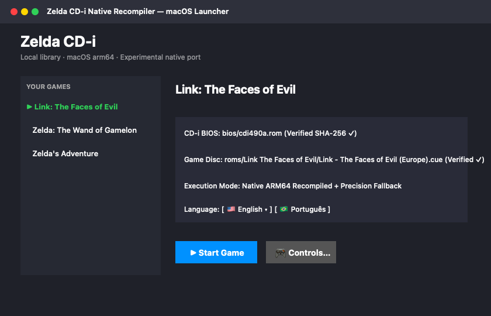
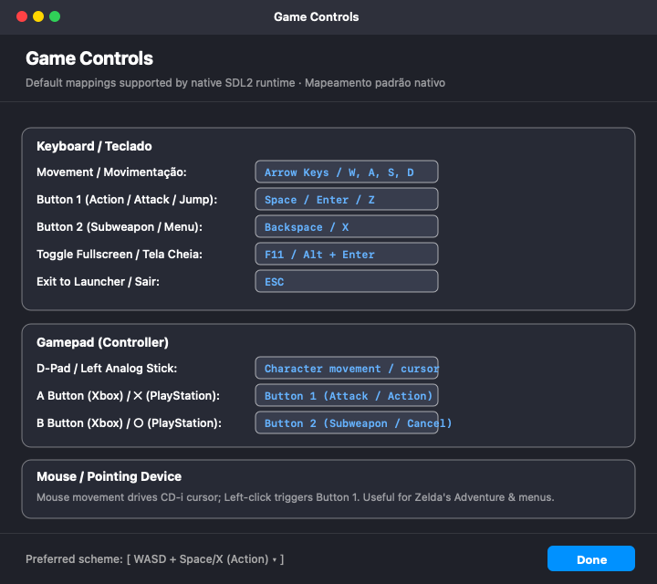
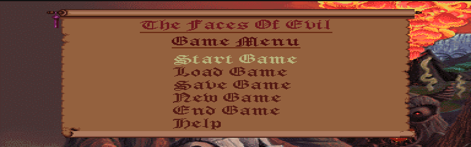
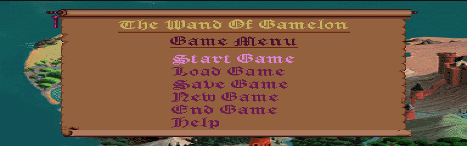
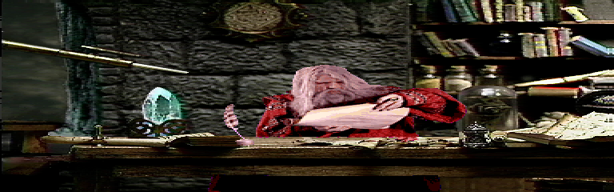

# Zelda CD-i Native Recompilation

[](#estado-atual)
[](#estado-atual)
[](#licença-e-proveniência)

[English](README.md) | Português do Brasil

Pesquisa de recompilação nativa e player para **Link: The Faces of Evil**, **Zelda: The Wand of Gamelon** e **Zelda's Adventure**, do Philips CD-i.

O código SCC68070 / CD-RTOS / OS-9 é recompilado estaticamente para código nativo, com **fallback interpretado medido** nos caminhos ainda sem cobertura. REA/Ghidra auxilia a análise; CdiRecomp continua sendo o emissor. O runtime é híbrido e experimental; campanhas completas e fidelidade continuam em investigação.

## Progresso e quadro Kanban

<!-- BACKLOG:START -->
[Abrir quadro Kanban](https://github.com/users/Megamil-Decomp/projects/1/views/2) · [Backlog e critérios de aceitação](docs/BACKLOG.md)

**15 / 31 entregas cadastradas concluídas (48%)** · atualizado em 2026-10-29.

Concluído: **15** · Em andamento: **5** · A validar: **3** · Backlog: **8**.

A contagem dá o mesmo peso a cada entrega; não é percentual de campanha, esforço, fidelidade ou cobertura nativa. Ampliar o escopo pode reduzir o percentual.

| Área | Concluídas / cadastradas | Entregas |
| --- | ---: | ---: |
| Base e fidelidade | 2 / 4 | 50% |
| Recompilação e runtime | 5 / 8 | 62% |
| Compatibilidade dos jogos | 3 / 7 | 43% |
| Interface e controles | 2 / 4 | 50% |
| Plataformas e exportação | 2 / 5 | 40% |
| Localização PT-BR | 1 / 3 | 33% |
<!-- BACKLOG:END -->

O quadro usa **Backlog → Em andamento → A validar → Concluído**, com critério de aceitação, área e prioridade em cada issue. As evidências e limitações ficam no [progresso técnico](docs/PROGRESS.md).

## Estado atual

Última build privada aceita para Mac: **0.1.7 (build 8), 29/10/2026**. Não há download público do pacote completo com os jogos.

| Área | Implementado ou observado | Ainda pendente |
| --- | --- | --- |
| Faces of Evil | Menu e trechos iniciais, movimento/combate e retorno ao mapa | Outros percursos, campanha e comparação independente de fidelidade |
| Wand of Gamelon | Entradas estáticas com auxílio do REA; mapa e área de Sakado/loja | Ensaios pareados e áreas posteriores/campanha |
| Zelda's Adventure | Percurso conhecido a 1x, carregamento de save, transição, dano/retorno e inventário | Fluxo de tela preta sem causa conclusiva, outras áreas/campanha |
| macOS arm64 | Launcher bilíngue, validação de mídia, saves por título, menu, mouse e exportação portátil | Controle/áudio físicos e teste em outro Mac/macOS 13 |
| Windows x64 | Runtimes cross-compilados, launcher Win32 e exportador privado completo | Execução real; ZIP de teste anterior não contém o novo menu |
| Steam Deck / Linux | Plano de port e código de entrada compartilhado | Ensaios em hardware/Proton e empacotamento Linux nativo |
| PT-BR | Piloto opcional de Adventure: slot vazio e cinco rótulos de botões | Demais textos dos jogos, fontes/recursos e legendas |

Em Adventure, o percurso adicional comparado passou de **89,19% para 92,20% de instruções nativas, incluindo BIOS**. Outro percurso a 1x mediu 92,27%. São proporções de instruções de trechos específicos, não percentuais de campanha concluída nem benchmarks de velocidade. [Método, resultados e limites](docs/PROGRESS.md).

Validação registrada para 0.1.7: **142 testes Python**, **11/11 CTests por runtime** (três builds), interação real no Mac com menu/mouse e boot/encerramento dos três executáveis empacotados. Esses testes não incluem áudio/controle físicos nem execução no Windows.

## Menu durante o jogo e controles

**F1 / Start** abre opções e pausa a execução do jogo e o áudio do host. Oferece tela cheia, três tamanhos de janela, volume, mouse/captura e mapa informativo dos botões. As preferências ficam em `frontend.cfg`, separado por título.

| Ação | Teclado / mouse | Mapeamento SDL do controle |
| --- | --- | --- |
| Direção | Setas ou WASD | D-pad / analógico esquerdo com deadzone |
| Botão 1 do CD-i | Espaço / Enter / Z / clique esquerdo | A |
| Botão 2 do CD-i | Backspace / X / clique direito | B |
| Opções / continuar | F1 (talvez Fn + F1 no Mac) | Start |
| Tela cheia | F11 ou Alt + Enter | Disponível nas opções |
| Prender / soltar cursor | F2 | Disponível nas opções |
| Voltar no menu do host | Esc | B |
| Sair do jogo | Cmd + Q / Cmd + Esc, ou menu de opções | Disponível nas opções |

A/B são os nomes do mapeamento SDL; os rótulos impressos variam entre controles. O analógico direto está implementado e passou em testes sintéticos; falta o ensaio com controle físico. O launcher ainda precisa de teclado/mouse.

O mouse funciona na janela do jogo com foco **sem exigir captura**. O movimento é relativo: não posiciona o cursor CD-i exatamente na mesma coordenada do ponteiro do computador. F2 prende/libera o cursor opcionalmente. Abrir o menu descarta cliques pendentes e libera a captura.

## Exportar uma cópia privada para teste

Em um ambiente já preparado, com aplicativo Mac aceito e mídias locais correspondentes:

```sh
python3 scripts/export_private_macos.py
```

O comando cria uma pasta datada nova em `dist/exports/`, ignorada pelo Git, com BIOS/discos correspondentes, dependências e launcher, sem saves pessoais. No outro Mac Apple Silicon, descompacte o ZIP e abra o `.app` inteiro. O destino não precisa de Python, REA, Homebrew ou compilador. A assinatura é local, sem notarização Apple. [Detalhes da exportação Mac](docs/PRIVATE_EXPORT.md).

A construção/exportação Windows usa o mesmo projeto:

```sh
python3 scripts/export_private_windows.py
```

Exige catálogo aceito preparado e ferramentas de cross-compilação na origem. A pasta Windows inclui as DLLs e mídias locais. **O teste em Windows real continua pendente.** [Checklist de teste](docs/WINDOWS_TESTING.md) · [Portabilidade](docs/PORTABILITY.md) · [Plano Steam Deck](docs/STEAM_DECK_PLAN.md).

Exportações completas permanecem privadas e fora do Git. Não são fornecidos downloads de jogos ou BIOS.

## Compilar uma base de pesquisa no macOS

Exige **Apple Silicon / macOS 13+**, Python 3, Git, Xcode Command Line Tools e CMake. Esses requisitos são para desenvolvimento; a exportação privada pronta não precisa dessas ferramentas.

```sh
xcode-select --install
brew install cmake

git clone https://github.com/Megamil-Decomp/zelda-cdi-recomp.git
cd zelda-cdi-recomp

git clone https://github.com/mstan/cdirecomp.git upstream-cdirecomp
git -C upstream-cdirecomp checkout f3c8d579efb11d5a33c6bc7c935dfbced773e62e
git -C upstream-cdirecomp submodule update --init --recursive
```

Leia a [auditoria de licença e proveniência](docs/UPSTREAM_AUDIT.md). O build confere as revisões auditadas e aplica patches em cópia privada de staging. Um SDK SDL2 fixado é obtido da publicação oficial e compilado em diretório privado com alvo macOS 13, sem substituir a instalação global.

Forneça seus próprios dumps compatíveis nestas pastas ignoradas pelo Git:

```text
bios/
  cdi490a.rom
roms/
  Link The Faces of Evil/
    Link - The Faces of Evil (Europe).cue
    Link - The Faces of Evil (Europe).bin
  Zelda The Wand of Gamelon/
    Zelda - The Wand of Gamelon (Europe).cue
    Zelda - The Wand of Gamelon (Europe).bin
  Zeldas Adventure/
    Zelda's Adventure (Europe).cue
    Zelda's Adventure (Europe).bin
```

A BIOS tem 524.288 bytes; formatos big-endian e swap16 são conferidos/normalizados localmente. Os discos usam pares CUE/BIN raw Mode-2 suportados. É necessária a revisão correspondente, não apenas o nome do arquivo. [Requisitos de mídia](docs/ROM_REQUIREMENTS.md).

```sh
python3 scripts/build_native_runtimes.py --jobs 4
python3 scripts/build_macos_app.py
open "dist/Zelda CD-i.app"
```

As saídas ficam em `build/` e `dist/`, ignorados. Esses comandos geram uma **base de pesquisa**. A build otimizada aceita 0.1.7 também usa seeds observadas localmente e catálogo explícito de runtimes privados; código derivado dos jogos não é distribuído. Uma base recém-gerada não deve ser considerada equivalente em cobertura ou aceitação ao candidato privado. [Fluxo REA](docs/REA_WORKFLOW.md) · [Construção do menu](docs/PLAYER_MENU_PLAN.md).

Para testar as ferramentas próprias com dados sintéticos:

```sh
python3 -m unittest discover -s tests -v
```

## Capturas de tela

Registros históricos de desenvolvimento; não certificam a build mais recente nem a campanha completa.

| Launcher | Controles |
| --- | --- |
|  |  |

| Faces of Evil | Wand of Gamelon | Zelda's Adventure |
| --- | --- | --- |
|  |  |  |

## Documentação

- [Backlog, prioridades e critérios de aceitação](docs/BACKLOG.md)
- [Progresso técnico e limitações](docs/PROGRESS.md) · [Decisões](docs/DECISIONS.md)
- [Arquitetura](docs/ARCHITECTURE.md) · [Marcos técnicos originais](docs/ROADMAP.md)
- [Localização opcional](docs/LOCALIZATION.md) · [Fluxo de análise REA](docs/REA_WORKFLOW.md)

## Licença e proveniência

A [MIT](LICENSE) aplica-se ao código de host e às ferramentas originais criadas aqui. **Ela não relicencia o runtime upstream, o núcleo do recompilador, o contexto dos patches ou código comercial dos jogos.** O upstream auditado contém termos não comerciais específicos sob o título PolyForm Noncommercial; consulte a [auditoria](docs/UPSTREAM_AUDIT.md) antes de reutilizar ou distribuir derivados. SDL usa sua própria licença zlib.

BIOS, discos, recursos extraídos, saves e código comercial gerado ficam fora do Git. Use suas próprias mídias compatíveis; builds completas permanecem privadas. O projeto não é afiliado à Nintendo ou à Philips.

Agradecimentos a [mstan/cdirecomp](https://github.com/mstan/cdirecomp) e seu núcleo m68k, [N64Recomp](https://github.com/N64Recomp/N64Recomp), [Zelda64Recomp](https://github.com/Zelda64Recomp/Zelda64Recomp) e SDL pelas pesquisas, referências e tecnologia do host.
